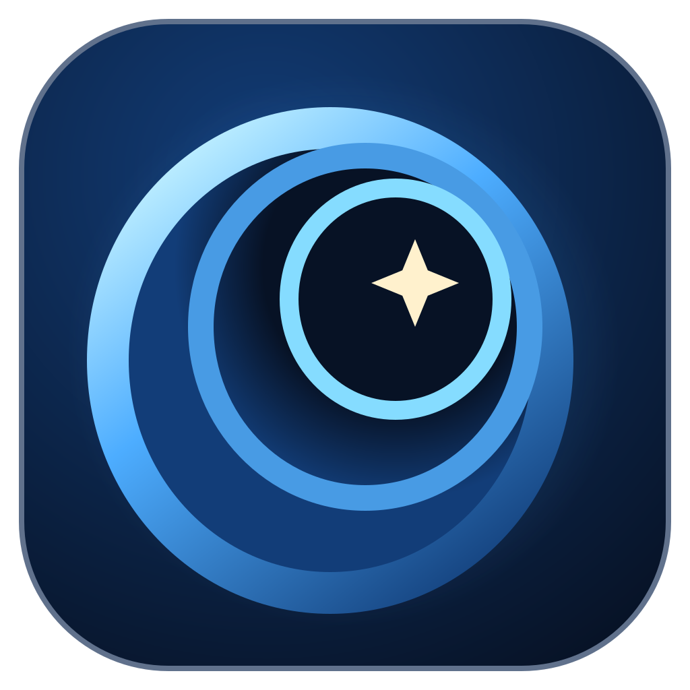
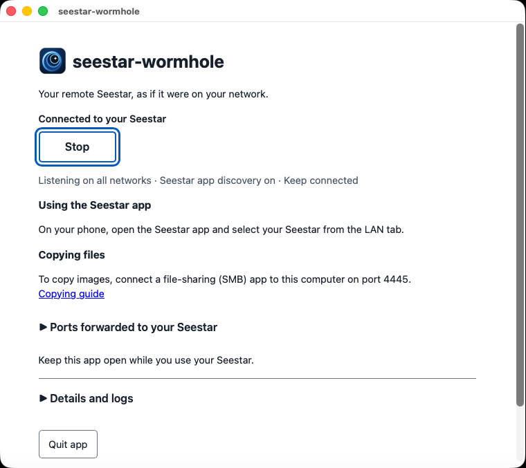

#  seestar-wormhole

A Seestar kept at a remote site is reachable from the phone app through ZWO's
cloud, but nothing else can reach it: not
[seestar_alp](https://github.com/smart-underworld/seestar_alp), not scripts,
not a plain file copy of last night's images. They all expect to be on the
telescope's own Wi-Fi.

seestar-wormhole opens [the same Telescope Network cloud
connection the app uses](https://github.com/zmerlynn/seestar-spec/blob/v1/spec/auth/cloud-auth/http-api.md#allocation-online-link), then hands the telescope's ports to your computer as
if the telescope were sitting on your desk. The phone app finds it on your home
Wi-Fi. seestar_alp connects to it. Images download from it. Everything shares
one connection.

Daily-use coverage is on firmware 9.31, with control testing on 9.75; see [device and firmware coverage](docs/status.md#telescopes).

## Install

Download the archive for your system from the
[Releases page](https://github.com/zmerlynn/seestar-wormhole/releases), unpack
it, and check it runs:

```sh
./seestar-wormhole --version
```

See the [versioning policy](docs/versioning.md) for what a release promises.

For browser controls, run `./seestar-wormhole` on macOS or Linux, or
`.\seestar-wormhole.exe` in PowerShell on Windows. Add `ui` to the command to open
the controls explicitly. Enter your account and choose Connect. First run selects
Phone on this network and shows its network trust warning. Successful connection
saves non-secret settings; Save password to keychain is a separate choice.
Stop releases the session; Quit exits. See [GUI controls](docs/reference.md#ui).



It's a single executable; browser controls need a browser, and optional password
storage needs an available OS keychain.

To build from source, install Go 1.27 or newer and run the command below; see [building from source](docs/development/README.md#build-and-run).

```sh
CGO_ENABLED=0 go build -mod=vendor -o seestar-wormhole ./cmd/seestar-wormhole
```

## Before you start: your account and your site

seestar-wormhole signs in with your Seestar account, the same one the app
uses. The `proxy` command reads the email and password from `SEESTAR_EMAIL` and
`SEESTAR_PASSWORD` and keeps them in memory only. Typing them in like this
(in bash or zsh) keeps them out of your shell history:

```sh
printf 'Seestar email: '; IFS= read -r SEESTAR_EMAIL
printf 'Seestar password: '; IFS= read -rs SEESTAR_PASSWORD; echo
export SEESTAR_EMAIL SEESTAR_PASSWORD
```

When you're done, `unset SEESTAR_EMAIL SEESTAR_PASSWORD`.

[The device keeps the site and clock it has.](https://github.com/zmerlynn/seestar-spec/blob/v1/spec/control/time-and-location.md#overview) The proxy drops the app's location
and time setters, so your phone cannot move the telescope into your living
room. From a few thousand miles away, that matters: the wrong site makes the
telescope compute the wrong sky, miss targets, and fail to plate solve. A plan
in the wrong time zone starts at the wrong hour, too.

Before using the proxy, make sure the telescope has the right site. To change it, connect the app directly to the device; the device keeps its own clock. See [site protection](docs/reference.md#site-protection).

## Use the phone app from home

Run seestar-wormhole on the same Wi-Fi network as your phone. Turn on LAN discovery and map local port 80:

```sh
./seestar-wormhole proxy --bind 0.0.0.0 --lan-discovery -p 80:80
```

Then open the Seestar app and select the telescope from its **LAN** tab, not Remote. The [phone setup guide](docs/phone-app.md#start-the-proxy) covers permissions and troubleshooting. See [platform coverage](docs/status.md#platforms) for discovery validation.

## Keep it running

By default the proxy connects at startup and holds the session until stopped; stop it and wait for it to exit before switching to the app’s remote mode. Add `--idle 2m` to connect only when a client arrives. See [session availability and handover](docs/reference.md#availability-and-busy-devices).

The [always-on guide](docs/always-on.md) covers running it as a service, in a
container, and on Windows.

## Copy images while you keep observing

rclone copies images through the proxy's SMB listener while control clients
share the session. See [Copy images](docs/copying.md) for setup,
transfer settings, and byte verification on Linux, macOS, and Windows.

## Keep it on your own network

The proxy listens on local interfaces and has no authentication; use it only on a network you trust. See [local network trust](docs/reference.md#proxy).

## Status

See [tested coverage](docs/status.md) for the devices, firmware and paths exercised.

## AI use

seestar-wormhole was written by AI, guided by a human maintainer. AI models
(Anthropic's Claude and OpenAI's GPT models) wrote the code, tests and
documentation and reviewed the changes. A human maintainer set the scope and
the clean-room rules, made the design decisions, provided the telescope it
was tested against and approves what is published.
[Tested coverage](docs/status.md) says what has been exercised on a real
device. Please report errors as issues.

## Affiliation and warranty

seestar-wormhole isn't affiliated with, endorsed by or supported by ZWO or
ThroughTek. Seestar, ZWO, Kalay and other names are trademarks of their owners
and are used only to identify what this software works with. It's built from
observed behavior of the maintainer's telescope and from public information,
and it signs in with your own account through the same cloud service the
official app uses.

It's provided as is, without warranty of any kind (see [LICENSE](LICENSE)). It
has been tested only on the devices and firmware listed in
[tested coverage](docs/status.md); others may differ. Using it is at your own
risk: apart from [site protection](docs/reference.md#site-protection), the
proxy forwards what your app or client sends, including commands that move the
mount, change settings or delete files, and use of the vendor's cloud service
is subject to its terms.

## More

See [internal package boundary](docs/development/README.md).

- [Phone app guide](docs/phone-app.md)
- [Always-on guide](docs/always-on.md)
- [Copy images](docs/copying.md)
- [seestar_alp and other clients](docs/clients.md)
- [Command reference](docs/reference.md): every flag, exit code and log message
- [How the proxy speaks the protocol](docs/protocol.md)
- [Troubleshooting](docs/troubleshooting.md)
- [Known issues and accepted limits](docs/known-issues.md)
- [How it works and how to hack on it](https://github.com/zmerlynn/seestar-wormhole/blob/main/docs/development/README.md) (in the source repository)
- [Contributing](CONTRIBUTING.md)
- [License](LICENSE) and [third-party notices](NOTICE)
