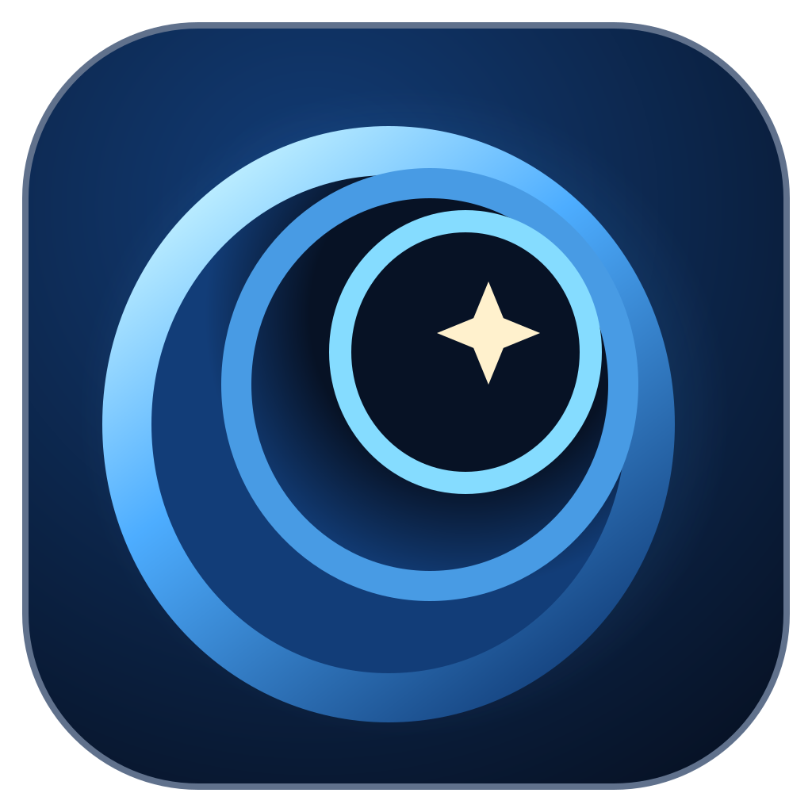
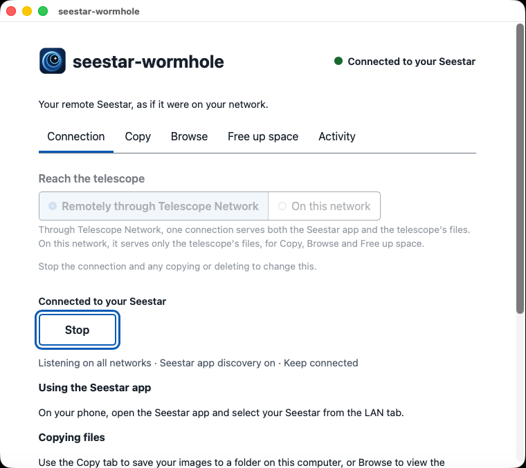

#  seestar-wormhole

A Seestar kept at a remote site is reachable from the phone app through ZWO's
cloud, but nothing else can reach it: not
[seestar_alp](https://github.com/smart-underworld/seestar_alp), not scripts,
not a plain file copy of last night's images. They all expect to be on the
telescope's own Wi-Fi.

seestar-wormhole opens [the same Telescope Network cloud
connection the app uses](https://github.com/zmerlynn/seestar-spec/blob/v1/spec/auth/cloud-auth/http-api.md#allocation-online-link), then hands the telescope's ports to your computer as
if the telescope were sitting on your desk. The phone app finds it on your home
Wi-Fi. seestar_alp connects to it. Images download from it. Everything shares
one connection.

Daily-use coverage is on firmware 9.31, with control testing on 9.75; see [device and firmware coverage](docs/status.md#telescopes).

## Install

Download the archive for your platform from the
[Releases page](https://github.com/zmerlynn/seestar-wormhole/releases) and
unpack it. On macOS, open the `.dmg` and drag seestar-wormhole to
Applications.

Windows downloads are not code-signed, so Windows may show
"Windows protected your PC". Choose **More info**, then
**Run anyway**.

Every download has the app and a command-line tool:

- `seestar-wormhole` is the app. It connects, and copies, browses and frees
  up space on the telescope.
- `seestar-wormhole-cli` runs the proxy, and copies, browses and frees up
  space on the telescope, from terminals, scripts and services.

On Linux the app needs GTK 4, WebKitGTK 6.0 and bubblewrap, and permission to
create the user namespaces WebKit's sandbox uses; see
[Linux native window](docs/troubleshooting.md#linux-native-window). On Windows
it needs the Microsoft Edge WebView2 Runtime. The command-line tool needs
nothing extra.

On macOS, the command-line tool sits beside the app on the disk image, and
dragging the app doesn't install it. To use it, copy `seestar-wormhole-cli`
from the disk image to a folder of your own, such as `~/bin`, before you eject
it.

Check the command-line tool from the folder that holds it:

```sh
./seestar-wormhole-cli --version
```

These examples, and the copy guide's, run the tool from that folder. In
PowerShell, write `.\seestar-wormhole-cli.exe` for `./seestar-wormhole-cli`.

Earlier releases also shipped a separate `seestar-copy-cli`; its commands are
now `seestar-wormhole-cli sync`, `find`, `browse` and `delete`; `scan` lists
the telescopes on this network.

See the [versioning policy](docs/versioning.md) for what a release promises.
Saving the password needs an available OS keychain.

To build from source, install Go 1.27 or newer and build the CLI with the command below; see [building from source](docs/development/README.md#build-and-run).

```sh
CGO_ENABLED=0 go build -mod=vendor -o seestar-wormhole-cli ./cmd/seestar-wormhole
```

## Before you start: your account and your site

Through Telescope Network, seestar-wormhole signs in with your Seestar
account, the same one the app uses. Copying from a telescope on the same
network as this computer needs no account.

[The device keeps the site and clock it has.](https://github.com/zmerlynn/seestar-spec/blob/v1/spec/control/time-and-location.md#overview) The proxy drops the app's location
and time setters, so your phone cannot move the telescope into your living
room. From a few thousand miles away, that matters: the wrong site makes the
telescope compute the wrong sky, miss targets, and fail to plate solve. A plan
in the wrong time zone starts at the wrong hour, too.

Before using the proxy, make sure the telescope has the right site. To change it, connect the app directly to the device; the device keeps its own clock. See [site protection](docs/reference/connection-cli.md#site-protection).

## Use the UI

Open seestar-wormhole (from Applications on macOS). On the **Connection** tab,
under **Reach the telescope**, choose how to reach your Seestar:

- **Remotely through Telescope Network** serves both the Seestar app and the
  telescope's files. Under **Use with**, keep **Phone on this network** for
  the phone app (see [the phone app guide](docs/phone-app.md#start-the-proxy)
  for permissions), or choose **This computer only** for apps on this
  computer. Enter your Seestar account and choose **Connect**. Once
  connected, it shows how to select the telescope in the phone app and how
  to copy images.
- **On this network** serves only the telescope's files, from a Seestar on
  the same network as this computer. Enter its
  [address](docs/copying.md#find-the-telescopes-address) and choose **Save**.
  No account is needed, and the proxy doesn't start.



Settings other than the password are saved after a successful connection;
**Save password to keychain** is optional. **Stop** releases the telescope so
the Seestar app's Remote mode can use it; **Quit** exits. See [Using the UI](docs/ui.md).

The **Copy**, **Browse** and **Free up space** tabs copy your images to a
folder on this computer, show what is on the telescope, and delete what is
safely copied. They work remotely through Telescope Network or, for a
telescope on the same network as this computer, directly. See [Copy images](docs/copying.md).

## Use the command line

### Sign in

The `proxy` command reads the email and password from `SEESTAR_EMAIL` and
`SEESTAR_PASSWORD` and keeps them in memory only. Typing them in like this
(in bash or zsh) keeps them out of your shell history:

```sh
printf 'Seestar email: '; IFS= read -r SEESTAR_EMAIL
printf 'Seestar password: '; IFS= read -rs SEESTAR_PASSWORD; echo
export SEESTAR_EMAIL SEESTAR_PASSWORD
```

When you're done, `unset SEESTAR_EMAIL SEESTAR_PASSWORD`.

### Use the phone app from home

Run seestar-wormhole on the same Wi-Fi network as your phone. Turn on LAN discovery and map local port 80:

```sh
./seestar-wormhole-cli proxy --bind 0.0.0.0 --lan-discovery -p 80:80
```

Then open the Seestar app and select the telescope from its **LAN** tab, not Remote. The [phone setup guide](docs/phone-app.md#start-the-proxy) covers permissions and troubleshooting. See [platform coverage](docs/status.md#platforms) for discovery validation.

### Keep it running

By default the proxy connects at startup and holds the session until stopped; stop it and wait for it to exit before switching to the app’s remote mode. Add `--idle 2m` to connect only when a client arrives. See [session availability and handover](docs/reference/connection-cli.md#availability-and-busy-devices).

The [always-on guide](docs/always-on.md) covers running it as a service, in a
container, and on Windows.

### Copy images while you keep observing

`seestar-wormhole-cli sync` copies images through the proxy's SMB listener
while control clients share the session:

```sh
./seestar-wormhole-cli sync --endpoint 127.0.0.1:4445 --dest ~/Seestar
```

It also works directly with a telescope on your network. rclone and other SMB
apps work too. See [Copy images](docs/copying.md) and the
[file command reference](docs/reference/files-cli.md).

## Keep it on your own network

The proxy listens on local interfaces and has no authentication; use it only on a network you trust. See [local network trust](docs/reference/connection-cli.md#proxy).

## Status

See [tested coverage](docs/status.md) for the devices, firmware and paths exercised.

## AI use

seestar-wormhole was written by AI, guided by a human maintainer. AI models
(Anthropic's Claude and OpenAI's GPT models) wrote the code, tests and
documentation and reviewed the changes. A human maintainer set the scope and
the clean-room rules, made the design decisions, provided the telescope it
was tested against and approves what is published.
[Tested coverage](docs/status.md) says what has been exercised on a real
device. Please report errors as issues.

## Affiliation and warranty

seestar-wormhole isn't affiliated with, endorsed by or supported by ZWO or
ThroughTek. Seestar, ZWO, Kalay and other names are trademarks of their owners
and are used only to identify what this software works with. It's built from
observed behavior of the maintainer's telescope and from public information,
and it signs in with your own account through the same cloud service the
official app uses.

It's provided as is, without warranty of any kind (see [LICENSE](LICENSE)). It
has been tested only on the devices and firmware listed in
[tested coverage](docs/status.md); others may differ. Using it is at your own
risk: apart from [site protection](docs/reference/connection-cli.md#site-protection), the
proxy forwards what your app or client sends, including commands that move the
mount, change settings or delete files, and use of the vendor's cloud service
is subject to its terms.

## More

The [documentation](docs/README.md) lists every guide and reference by task.

- [How it works and how to hack on it](https://github.com/zmerlynn/seestar-wormhole/blob/main/docs/development/README.md) (in the source repository); see also the [internal package boundary](docs/development/README.md)
- [Contributing](CONTRIBUTING.md)
- [License](LICENSE) and [third-party notices](NOTICE)

## Support this project

Tips are welcome and never required:
[GitHub Sponsors](https://github.com/sponsors/zmerlynn) or a
[one-time tip](https://buy.stripe.com/bJe3cxgMNaWbgCfe9E5wI00). A tip is a
thank-you; it doesn't buy support, priority or features.
