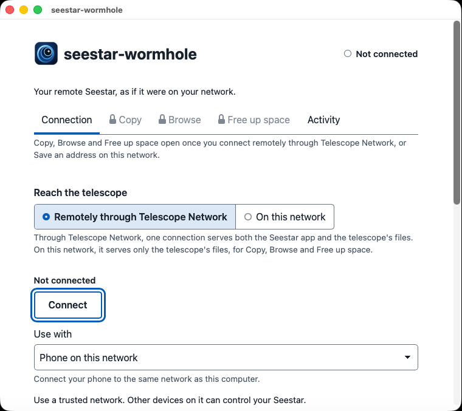

# Using the UI

seestar-wormhole connects apps on your computer and phone to your remote Seestar.
They share one connection to the telescope.

## Tabs

The header shows a dot and a line with the connection's state: **Not
connected**, the status while connecting, or **Connected to** your Seestar. On
this network it shows the saved address, then **On this network: reachable**
or **Can't reach** the address once **Test** has run. While copying is on, a
chip after the line says how it stands: **Copying**, **Up to date**, how many
files were not copied, or **Copying is on**. A copy once shows **Copying**
while its check runs. With copying off, there is no chip.
While a run is busy, a chip of its own follows: **Previewing copy**, **Checking
what to delete**, **Checking N files again** or **Deleting 3 of 12**. It goes
away when the run ends. Each chip opens its tab, Copy or Free up space. A run's
start is announced once when another tab is open, each time it starts.

Below it are the tabs **Connection**, **Copy**, **Browse**, **Free up space**
and **Activity**. Use the Left and Right arrow keys, Home and End to move
between them. Copy, Browse and Free up space open once you connect remotely
through Telescope Network, or save an address on this network; until then
they are dimmed, show a padlock, and say so. Quit and the version are below every tab.

## Reaching the telescope

**Connection** starts with **Reach the telescope**, and a line under it says
what each choice gives: through Telescope Network, one connection serves
both the Seestar app and the telescope's files; on this network, it serves
only the telescope's files, for Copy, Browse and Free up space.

- **Remotely through Telescope Network** is the setup on the rest of this
  page: the proxy signs in with your Seestar account and connects to your
  Seestar through Telescope Network, and copying will use its file-sharing
  (SMB) port.
- **On this network** is for a Seestar on the same network as this computer.
  Enter its [address](copying.md#find-the-telescopes-address), with an
  optional port (445 by default); its help says
  that Copy, Browse and Free up space read the telescope's files there.
  **Test** checks that it answers file sharing and saves nothing: when it
  passes for an address other than the saved one, it says to **Save**.
  **Save** tests it first, unless it has just passed, then checks that it
  still answers (the line under the address says **Checking…**) and saves
  it only if it does; Copy, Browse and Free up space then use it. Otherwise
  the saved route stays.
  On a Mac, when nothing answers at the address, Test or Save also says to
  enable seestar-wormhole in System Settings → Privacy & Security → Local
  Network, which macOS may be blocking; see [Local Network access](copying.md#things-to-know).
  This route doesn't start the proxy or use your account.

You can't change the choice while a connection is running or while copying or
deleting is running; stop it first. **Connect** saves the Telescope Network route, so
it is refused too while copying or deleting runs on this network.

## Setting up

Under **Use with**, choose who can connect:

- **Phone on this network** is selected the first time. It listens on all
  networks, lets the Seestar app find your telescope, and serves image downloads
  on local port 80. Keep your phone on the same network as this computer. Use a
  trusted network: other devices on it can control your Seestar.
- **This computer only** accepts apps on this computer only. Discovery is off,
  and image downloads use local port 8080.
- **Custom** uses your own settings under **Advanced**. Changing any of them
  selects **Custom**; picking another setup replaces them.

Enter your Seestar account email and password. Nothing connects until you
choose **Connect**, and next time your choices are already filled in.

Your password stays in memory until you quit. To skip typing it next time,
choose **Save password to keychain**; the field then shows **Saved in
keychain**. Your password is never saved in plain text.

To change a saved password, choose **Remove saved password** and type the new
one. If removal fails, unlock your keychain and choose **Retry removal**. See
[keychain troubleshooting](troubleshooting.md#the-os-keychain-is-unavailable).

## Connecting

Choose **Connect**. While a connection is running, the button becomes **Cancel**
or **Stop**. The status tells you what's happening:

| Message | What to do |
|---|---|
| **Connected to your Seestar** | Start using your apps. |
| **Waiting for an app to connect** | Connect an app to a forwarded port. The session starts when one does. |
| **Seestar is occupied. Retrying automatically.** | Disconnect any other remote session, or wait for it to let go. |
| **Seestar isn't reachable. Check this computer's internet connection and make sure Seestar is awake and connected to Wi-Fi. Retrying automatically.** | Check this computer's internet connection and make sure Seestar is awake and connected to Wi-Fi; seestar-wormhole keeps trying. |
| **Connection interrupted. Retrying automatically.** | Wait; seestar-wormhole reconnects on its own. |
| **Waiting before retrying the connection…** | Wait for cleanup and the retry delay. |
| **Stopped. Seestar may still be releasing the session.** | Give it time before using another remote session. |
| **Session release could not be confirmed. If Seestar is occupied, wait and try Connect again.** | Wait, then choose **Connect** again. |
| Could not sign in. Check your Seestar account email and password, then connect again. | Fix your account details and choose **Connect**. |

If a setting is wrong, its field shows what to fix.

Your settings are saved once a connection succeeds. If saving fails, the
connection keeps running and **Retry saving settings** appears.

If the window loses the controls, it shows the last known state and warns that
the proxy may still be running. Reopen seestar-wormhole to reconnect.

## While connected

The setup fields are replaced by a summary of listening, discovery, and
connection timing. Open **Ports forwarded to your Seestar** to see the ports in
use: **Local port** is on this computer, **Seestar port** is on the telescope,
and **Purpose** names the service. You can't edit them while connected.

When discovery is on, **Using the Seestar app** tells you to pick your
telescope from the **LAN** tab of the Seestar app. If it doesn't appear, see
the [phone app guide](phone-app.md). **Copying files** points you to the
**Copy** tab, with **Go to Copy**, and to **Browse**; below that, it shows the
local SMB port for [another file-sharing app](copying.md#copy-with-a-graphical-app).

Keep seestar-wormhole open while you use the telescope.

## Copying images

**Copy**, **Browse** and **Free up space** copy your images from the
telescope's file share to a folder on this computer, show what is on the
share, and delete what is safely copied. They use the same rules and the same
copy history as [`seestar-copy-cli`](copy-reference.md)'s `sync`, `browse` and
`delete`. Through Telescope Network they reach the share through the proxy's SMB port
(local port 4445 by default); on this network, at the saved address.

If they can't reach the share, each says why and links to the fix:

| Notice | Fix |
|---|---|
| **Not connected.** | **Go to Connection** and connect. On Copy, while copying repeats, the notice adds **Copying resumes at the next check after you connect.** Scheduled checks wait for the connection; they don't start it. |
| **SMB is off. Turn on its port in Connection > Advanced.** | **Open Advanced** and forward a local port to Seestar port 445. |
| **Save the telescope's address on the Connection tab first.** | **Go to Connection**, choose **On this network**, and save the address. |

### Copy

The first time you open Copy, **Copy settings** is open: choose the folder for
your images, with **Choose…** in the app's window or by typing its full path,
then **Save**. Saving doesn't start copying: a notice above the
buttons says copying starts when you press **Start copying**, and that
**Preview** shows what it would copy first. After that, Copy shows what
copying is doing, with
**Start copying**, **Preview**, **Check now** and **Stop copying**, and below
them a summary of the settings, such as "Copying to ~/Seestar every 5 min,
skipping logs and system files." **Change…** opens the settings, which you
can't change while copying runs:

- **Folder for your images.** Images are copied there in the same folders as
  on the telescope. Each folder has its own copy history.
- **Check for new files every** N minutes, 5 by default. Its checkbox, on by
  default, turns the repeating check off to copy once: **Start copying** then
  checks once, copies what is new and stops, and Copy says **Checked once;
  copying is off.** The summary then says "once each time you start".
- **Files at once**: how many files copying runs at once, 1 to 4, 4 by
  default. Through Telescope Network, copying shares the connection with
  the Seestar app and seestar_alp; if they are slow to respond while copying,
  lower it to 1 or 2.
- **Leave out** and **Only copy**: one pattern per line, as `sync`'s
  [`--exclude` and `--include`](copy-reference.md#selection).
- **Skip the telescope's logs, scratch and system files**, on by default.
- **Start copying when the app opens**, off by default. Through Telescope
  Network, copying then starts once the connection is ready; pressing
  **Start copying** before then takes its place. With the check for new
  files off, it copies once each time the app opens.

While copying is off, **Preview** shows what **Start copying** would do, from
one [dry run](copy-reference.md#dry-run) with the saved settings: how many
files it would copy and their size, with a row per folder, and how many are
already copied, still being written, or left out. Nothing is copied.
**Cancel** stops a preview that is running; starting, a Save that changes the
folder or the selection, and Clear history discard it.

While copying is on, the app holds the folder's lock, as `sync` does: a `sync`
for the same folder exits with its usual error, and Copy says **Another copy
is already using this folder.** while a `sync`, or another copy of the app with
another state directory, holds it.

**Copy history**, collapsed under the settings, shows the path of the saved
folder's [state file](copy-reference.md#the-state-file), which `sync` uses
too. While the folder field holds a folder not yet saved, it says to save
first. **Clear history…** deletes that state file after a confirmation, so the
app forgets what it copied to the folder. Files still in the folder are kept
and adopted on the next pass; files moved out of it are copied again. Clear
history is unavailable while copying is on, and refuses while Free up space
is checking or deleting, or while a `sync` holds the folder's lock.

### Browse

Browse is `seestar-copy-cli browse`'s page for the share, with the saved
folder's [statuses](copy-reference.md#statuses). What the settings leave out
shows as [`left out`](copy-reference.md#left-out-in-browse). After a Save
that changes the folder or the selection, or a change of how the telescope
is reached, Browse loads again at the share's top when it is next shown, so
an error from before goes without a retry. Until the
folder is saved, Browse says to choose it, with **Go to Copy**. In the app's
window, a file's **Save** asks where to save it; in a browser, it downloads.

### Free up space

**Preview what to delete** lists, per folder, the files that are copied and
safe to delete, as `delete` [proves it](copy-reference.md#proof-modes), and
nothing is deleted until you confirm. Uncheck a folder to keep it. **Only
files older than** N days (7 by default; 0 means any age) keeps recent
sessions on the telescope, and **My copies have moved or the drive is
offline** checks only the app's record of each copy, as `--trust-state`
does. **Keep on the telescope** and **Only free up** take one pattern per
line, as `delete`'s [`--exclude` and `--include`](copy-reference.md#selection):
a file that matches Keep on the telescope is never deleted, and when Only free
up is not empty, only files that match it are. They are separate from Copy's
**Leave out** and **Only copy**, which don't change what is deleted.
**Always kept**, beside them, lists what is never deleted, as `delete` leaves
it out by default: the telescope's log and scratch folders (`/log`,
`/tmp_stitch`, `/batch_stack_tmp`), names starting with a dot, unfinished
`.tmp` files, and Windows system files (`Thumbs.db`, `desktop.ini`,
`$RECYCLE.BIN`, `System Volume Information`). A Copy Save that changes the folder discards a
preview, and so does a change of how the telescope is reached, which also
clears a check that couldn't finish. **Delete N files…** asks once more. The delete then lists the checked
folders again, and only those, saying **Checking N files again before
deleting…**, and proves each file again just before it removes it: a file
that changed or went away since the preview is kept. **Stop** ends a delete
that is running.

## Stopping and quitting

**Stop** releases the telescope and leaves the window ready to connect again.
**Quit** stops copying and the connection and exits: browsing ends first,
then copying, a preview or a delete stops and is waited for, then the
connection, then the control page. A file partly copied is copied again next
time. Closing the window does the same and waits for the release. Logging out or shutting down also stops the
connection first, as far as your system allows.

Opening seestar-wormhole again with the same state directory brings the
existing window forward. If `seestar-wormhole-cli proxy` is already using the
same ports, stop it first.

## Telescope selection

The **Telescope** picker sits below the account fields. **Find on my account** is the
default: with one telescope on the account, Connect selects it. A saved Serial
and Model pair appears as a selected entry. If it is absent from the current
account's received list, its label is **Saved: {model} {serial}**, using the same
escaping and capping as received labels. When that is the only identity entry,
the picker help reads **Choose “Find on my account”, then Connect to load other telescopes.**
This replaces the discovery help. A received match has its normal label and
appears only once.

If the account has several telescopes, Connect shows **Choose a telescope**
and adds each model and full serial number to the picker. Its help reads
**Your account has several telescopes. Choose one, then Connect.** The picker
receives focus once, with Connect next in keyboard order. Choosing an entry
fills the exact account pair and shows **Ready to connect**; choose Connect
to start the session. The empty option now reads **Choose a telescope…**;
Connect with it still selected in this step keeps
the picker focused without another account request. Outside this step, including
a changed account, it reverts to **Find on my account**. Its associated help reads **Connect uses your only telescope, or asks which one if there are several.**
The selection-step help replaces that line; only one picker help line appears at a time.

Serials must be 1-64 printable ASCII bytes (0x21-0x7E; no spaces, controls, or non-ASCII). This bound also applies to saved settings and received picker choices. An invalid saved serial refuses loading without rewriting the file. See the [command reference](reference.md#device-selection) for selection rules.

**Enter manually…** reveals **Serial number** and **Model (optional)** below
the picker for manual entry. Connect follows the revealed fields in visual and
keyboard order; Tab from the picker reaches Serial next. In manual entry, an
empty Serial shows **Enter a serial number.** Connect validates it locally without
an account request. The instruction and validation error are associated with Serial. A usable serial
shows **Ready to connect**; Model remains optional. Choosing another entry hides these fields and
fills its exact pair; Find on my account clears both. The received list stays in memory
for this app run, including when the controls page is reopened. Only Serial and
Model are saved in the existing settings format. A selection failure for a
chosen pair says **Choose “Find on my account” to reload telescopes, or check Serial and Model.**
Absence from the catalog alone does not invalidate a saved pair; the detail
fallback still applies. The received telescope list is included in Recent events, the private log, and Copy diagnostic summary; see [Activity](#activity).

After selection, status includes the escaped model and full serial. Valid serials preserve printable ASCII verbatim without truncation. Only the model is capped at 64 display characters. For example: **Connected to Seestar S50 Pro {serial}**.
An empty model uses **Seestar {serial}**. Recent events and Copy diagnostic
summary carry the same status text.
Stop is the only action below the running status. To switch telescopes, choose
Stop, choose **Find on my account** or another picker entry, then Connect.
Several telescopes still enter the existing selection step. See
[device selection](reference.md#device-selection).

## Advanced

### Timing and idle

Under **Connection timing**:

- **Keep connected** starts the session when you connect and holds it until you
  stop.
- **Connect when an app needs Seestar** waits for an app.
  **Release after apps disconnect (minutes)** sets how long to wait after the
  last app leaves. The next app starts the session again.

### Listening and discovery

Under **Listen on**, choose **All networks**, **This computer only**, or
**Other…**. For **Other…**, enter this computer's IPv4 address in **Local
network address**.

**Let the Seestar app find your Seestar** answers discovery requests on your
network. It needs **All networks** or a local network IPv4 address. See
[LAN discovery](reference.md#lan-discovery) for network requirements and limits.

### Services and ports

The **Services** table has ten fixed rows. Leave a **Local port** empty to turn
that service off. Each enabled local port must be unique and between 1 and
65535. The phone setup maps local port 80 to Seestar port 80; the computer-only
setup uses local port 8080 instead. SMB uses local port 4445 for Seestar port
445. For other mappings, use the [command line](reference.md#port-mappings).

## Activity

The **Activity** tab lists the connection's recent events and copying's and
deleting's activity in one list, newest first, each tagged **Connection**,
**Copy** or **Delete**. **Details and logs** holds your connection and copy
settings as JSON, error codes, and the paths of the private log and the
settings files, `config.json` and `copy.json`.

**Copy diagnostic summary** copies one JSON object with the program name,
version, error code, connection and copy settings, the listed events, and the
log's path. The connection settings and events leave out addresses, paths,
credentials, tokens, account identifiers, and payloads. The copy settings
include your folder and patterns, and copy and delete activity names the
files it is about; check the summary before you share it.
Lifecycle events include the selected telescope model and full serial with the
same representation and model display cap as status. Each Connect that reads the account
catalog also records its telescope list, even for a single telescope:
`Account telescopes: {telescope}, …`. Unproven lists use
`Account telescopes (list may be incomplete): {telescope}, …`; empty lists
read `Account telescopes: none`. Long lists end with `… and N more`.
The private log includes an INFO `device_catalog` record with the pairs, count,
and completeness; see the [log reference](reference.md#logs).

Unchanged status polls preserve the text and nodes in Details and the service
tables so selected text stays selected. Changed content updates on the next poll.

The private logs use fixed message templates and categories, UTC timestamps, and
classified failure phases and reasons, with no raw protocol traces.

If seestar-wormhole fails to start, your system shows the error. On Windows,
the error says when you need the WebView2 Runtime.

## Running without the window

Once the UI has saved your settings, `seestar-wormhole-cli proxy --config` can
use them without a window. See [Use saved settings headless](reference.md#use-saved-settings-headless)
for password sources, overrides, and service setup.

## Details for admins

### Where settings live

The default state directory is:

| System | Directory |
|---|---|
| Linux | `$XDG_CONFIG_HOME/seestar-wormhole`, or `$HOME/.config/seestar-wormhole` |
| macOS | `$HOME/Library/Application Support/seestar-wormhole` |
| Windows | `%APPDATA%\seestar-wormhole` |

To use another existing installation root, run
`seestar-wormhole ui --state-dir PATH`. This doesn't move or copy its identity.

| File | Purpose |
|---|---|
| `config.json` | Settings except the password; see [the format](#configjson-version-1). |
| `copy.json` | Copy settings; see [the format](#copyjson-version-1). |
| `InterProcessKV/device_uuid` | Your [installation identity](reference.md#installation-identity), shared with `proxy --state-dir PATH`. |
| `gui.log`, `gui.log.1` | UI events as JSON lines, up to 64 KiB each, with one rotation. |
| `ui.lock` | Keeps one UI running per state directory. |
| `ui-runtime.json` | Private control port and token; removed on normal exit. |
| `webview-<random>/` | Windows only: a fresh private engine profile for each launch; see [engine data](#engine-data). |
| `ui-open.html` | Private browser page that grants access to the controls; removed on normal exit. |

The copy history and each folder's lock are not in the state directory. They
stay in `seestar-copy-cli`'s default [state location](copy-reference.md#location),
`seestar-copy` beside `seestar-wormhole` in the same system folder, whatever
`--state-dir` says, so the app and `seestar-copy-cli sync` share them and never
copy into one folder at once.

### config.json version 1

`version` is required and must be `1`. Missing members take these defaults:

| Member | Default and meaning |
|---|---|
| `bind` | IPv4 loopback, for this computer only. |
| `discovery` | `false` |
| `idle` | `"0"`; a nonnegative Go duration string, such as `"2m"`. |
| `serial`, `model`, `email` | Empty strings. |
| `ports` | `[]`, using the standard service mappings. |
| `remember_password` | `false` |
| `route` | Empty, meaning **Remotely through Telescope Network**. `"lan"` means the copier reaches the telescope on this network at `lan_address`; any other value means Telescope Network. |
| `lan_address` | Empty. The telescope's address on this network as `host:port`, saved by **On this network** > **Save**. |
| `route_established` | `false`. `true` once a connection through Telescope Network is ready or an address on this network passed Test and was saved; it opens **Copy**, **Browse** and **Free up space** at launch. A password save never sets it. |

These defaults differ from the UI's first-run phone setup.

Each `ports` override has lowercase numeric `local` and `device` members, from
0 to 65535. A `local` of 0 turns the service off; `device` must name a standard
service.

Unknown members survive a save. Reads are limited to 64 KiB and never rewrite
the file. A missing or unsupported version, including a newer one, is refused
and left untouched. A failed load never overwrites existing state.

### copy.json version 1

`version` is required and must be `1`. Missing members take these defaults,
and members this version doesn't know are kept when it saves. The file is
written when you save Copy settings or preview Free up space with changed
options, never on load.

| Member | Default and meaning |
|---|---|
| `folder` | `Seestar` in your home folder. |
| `interval_minutes` | `5` |
| `once` | `false`; `true` when **Check for new files every** is off: Start copying checks once, then stops. |
| `excludes`, `includes` | `[]`; **Leave out** and **Only copy**, one pattern each. |
| `skip_built_in` | `true`; Copy only. Free up space always leaves out the built-in patterns. |
| `start_copying` | `false` |
| `files_at_once` | `4`; **Files at once**, from `1` to `4`. A value outside that range stops the app at startup. |
| `older_than_days` | `7` |
| `trust_state` | `false` |
| `free_excludes`, `free_includes` | `[]`; **Keep on the telescope** and **Only free up**, one pattern each. |

The telescope's address is not in it; it comes from the route in `config.json`.

### File permissions

Saves are atomic. On Unix, the directory must be `0700` and its files `0600`;
unsafe permissions or links are refused. Windows uses the same protected current-user/SYSTEM ACLs as the
[installation identity](reference.md#windows). Use trusted parent
directories.

The CLI keeps its default identity in memory only. To share the UI's identity,
pass the same state root explicitly, or use `proxy --config`.

### The control page

The controls use a separate loopback listener on an automatic port, even when forwarding listens on other networks. Access takes a random
256-bit token: it starts in the URL fragment and goes in a header with every API
request. Treat that private URL as access to the controls.

To keep other websites out, the page uses exact Host checks, Origin checks on
JSON POST writes, request limits, framing by the same page only, a restrictive
content policy, and no-store/no-referrer headers. The copy API under
`/copy/api/` takes the same token and checks; Browse, under `/browse/`, is
served for a frame on the page. Other programs running as your user
are still trusted.

A browser opener gets only the path to `ui-open.html`, which redirects to the
controls, so the token stays out of its arguments. If opening fails,
seestar-wormhole prints the private URL; keep that output private. A crash can
leave `ui-open.html` behind; the next browser launch replaces it.

### Window limits

Dropping a file or link onto the window can replace the controls with another
page, and an engine popup can open another view or browser window. A page from
another origin can't read the control token or make authenticated control
requests, and the Wails command bridge is blocked, but nothing stops the
navigation or popups themselves. Reopen seestar-wormhole to bring the controls
back in the existing window. Right-click menus are the engine's defaults.

For Linux prerequisites, see [Linux native window](troubleshooting.md#linux-native-window).

### Engine data

On Windows, each launch gets a new `webview-<random>/` profile. After the
window closes, seestar-wormhole waits up to two seconds to remove it. If files
are still locked, it prints a warning but exits normally. Later launches try
again, including for the older `webview/` directory, and locked profiles don't
block startup. Leftover cache and session files stay in the private state directory until
they unlock or you remove them after exit. Profiles with unsafe permissions or
links are left for you to remove by hand.

On macOS (WKWebView) and Linux (WebKitGTK), the engines use their default
persistent stores outside the state directory. These aren't cleared on exit.
The page uses sessionStorage to authorize reloads and sets no cookies or
localStorage. No-store headers don't guarantee that an engine writes no session
or cache data, and what each engine keeps on disk hasn't been checked on every
platform.
