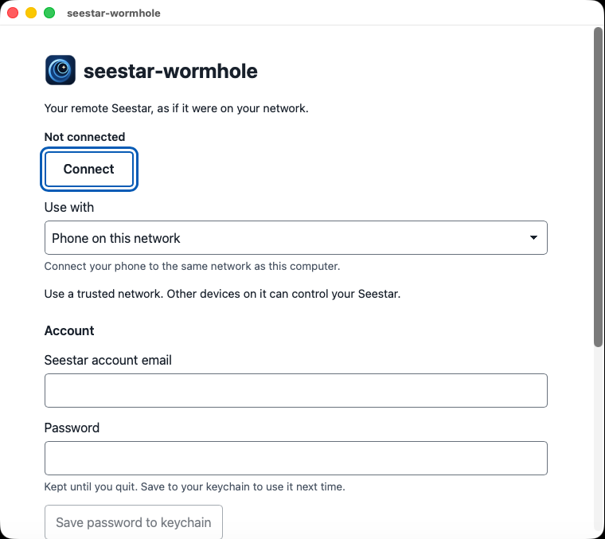

# Using the app

seestar-wormhole connects your remote Seestar to apps on your computer and phone.
They share one connection to the telescope.

## Setting up

Choose who can connect under **Use with**:

- **Phone on this network** is the first-run choice. It listens on all networks,
  turns on discovery, and uses local port 80 for image downloads. Keep your phone
  on the same network as this computer. Use a trusted network: other devices on
  it can control your Seestar.
- **This computer only** lets only apps on this computer connect. It turns off
  discovery and uses local port 8080 for image downloads.
- **Custom** lets you choose network and port settings in **Advanced**. Editing
  those settings selects **Custom**. Choosing another setup replaces them.

Your saved settings keep their network exposure and appear as
**This computer only** or **Custom**. Opening the app loads settings; it does not
connect to the telescope.

Enter your Seestar account email and password. The password stays in memory
until you quit unless you choose **Save password to keychain**. **Connect** never
saves a typed password to the keychain. There is no plaintext fallback, and the
controls never receive a saved secret.

Saving a password also saves your email and its keychain association, without
signing in. Next time, the disabled password field says **Saved in keychain**.
Opening the app does not read the secret or prompt for it; **Connect** reads it,
with a three-second wait limit.

To change it, choose **Remove saved password**, then type and optionally save
its replacement. Removal clears the memory copy and asks the keychain to delete
its copy. If deletion fails, the app keeps the saved association; unlock the
keychain and choose **Retry removal**. Removal updates your last saved settings
without saving other form edits. If a keychain request times out, it may still
finish. Wait before trying again; further keychain changes wait for that request.

## Connecting

Choose **Connect**. With **Keep connected**, the same button becomes **Cancel**
during the first connection, then **Stop**. In on-demand mode, it becomes
**Stop**. While cleanup runs, it becomes disabled and says **Stopping…**.

The status tells you what is happening:

| Message | What to do |
|---|---|
| **Connected to your Seestar** | Start using your apps. |
| **Waiting for an app to connect** | Connect an app to a forwarded port. The session starts when needed. |
| **Seestar is occupied. Retrying automatically.** | Disconnect any other remote session, or wait for it to release. |
| **Connection interrupted. Retrying automatically.** | Wait while the app reconnects. |
| **Waiting before retrying the connection…** | Wait for cleanup and the retry delay. |
| **Stopped. Seestar may still be releasing the session.** | Allow time for release before using another remote session. |
| **Session release could not be confirmed. If Seestar is occupied, wait and try Connect again.** | Wait, then choose **Connect** again. |
| Could not sign in. Check your Seestar account email and password, then connect again. | Correct your account details and choose **Connect**. A rejected sign-in ends the run after cleanup and leaves any saved password in place. |

Field errors point to the setting to correct. Address, discovery, port-permission,
and port-conflict errors have separate error codes. If the controls lose their
connection, they show the last known state and warn that the proxy may still be
running. Reopen the app to reconnect to the controls.

Settings save after a successful connection. With **Keep connected**, that means
the first ready connection with local listeners and discovery initialized. With
**Connect when an app needs Seestar**, settings save after sign-in, telescope
selection, and local setup. Failed connection attempts keep the last saved
settings. If saving fails, the connection keeps running. Choose
**Retry saving settings** to save that connection's settings. A newer successful
save replaces an older pending retry.

## While connected

The setup fields give way to a summary of listening, discovery, and connection
timing. Open **Ports forwarded to your Seestar** to see the ports in use. The
table is read-only while running: **Local port** is on this computer,
**Seestar port** is on the telescope, and **Purpose** names the service.

When discovery is on, **Using the Seestar app** tells you to open the Seestar
app on your phone and select your telescope from the **LAN** tab. See the
[phone app guide](phone-app.md) if it does not appear. **Copying files** shows
the local SMB port; see [copying images](copying.md).

Keep seestar-wormhole open while you use the telescope.

## Advanced

### Telescope selection

Leave **Serial number (optional)** and **Model (optional)** empty if your account
has one Seestar. For an account with several telescopes, enter the serial and
model exactly as shown in your account. See [device selection](reference.md#device-selection).

### Timing and idle

Under **Connection timing**, **Keep connected** starts the session when you
connect and holds it until you stop. **Connect when an app needs Seestar** waits
for an app. Set **Release after apps disconnect (minutes)** to choose how long
to wait after the last app disconnects. Another app connection starts the
session again.

### Listening and discovery

Under **Listen on**, choose **All networks**, **This computer only**, or **Other…**.
For **Other…**, enter this computer's IPv4 address in **Local network address**.

**Let the Seestar app find your Seestar** answers discovery requests on your
network. It needs **All networks** or a local network IPv4 address. See
[LAN discovery](reference.md#lan-discovery) for network requirements and limits.

### Services and ports

The **Services** table has ten fixed rows. Leave a **Local port** empty to turn
that service off. Enabled local ports must be unique and between 1 and 65535.
The phone setup maps local port 80 to Seestar port 80; the computer-only setup
uses 8080. SMB uses local port 4445 for Seestar port 445. For other mappings,
use the [command line](reference.md#port-mappings).

## Details and logs

Open **Details and logs** for connection settings as JSON, recent events in
local time, error codes, and the private log path. **Copy diagnostic summary**
copies one JSON object with the app name, version, connection settings, and
this launch's events in UTC. It leaves out addresses, paths, credentials,
tokens, account and device identifiers, and payloads.

The private logs use fixed messages and categories, UTC timestamps, and
classified failure phases and reasons. They contain no raw protocol traces.
The app appends events without loading earlier log history into the window or
copied summary. It refuses unsafe or oversized existing log files without
changing them. Startup failures also appear in the native error display;
Windows window-engine errors explain when WebView2 Runtime is required.

## Stopping and quitting

**Stop** releases the telescope session and leaves the window ready for another
connection. **Quit app** stops the connection and exits. Closing the window
also quits and waits for release. Native application quit and confirmed Windows
session end wait for release too; canceling Windows session end leaves the app
running. The OS can impose a shorter shutdown deadline.

If you started from a terminal, Ctrl+C quits too. Closing that terminal also
quits; on Windows, cleanup is best effort within the OS deadline.

Launch again with the same state directory to bring the existing window forward.
A separately running `proxy` command is independent. Free any conflicting
forwarding ports before starting another connection.

## Running without the window

After saving settings in the app, you can run `seestar-wormhole-cli proxy --config`
without a window. See [Use saved settings headless](reference.md#use-saved-settings-headless)
for password sources, overrides, and service setup.

## Where settings live

The default state directory is:

| System | Directory |
|---|---|
| Linux | `$XDG_CONFIG_HOME/seestar-wormhole`, or `$HOME/.config/seestar-wormhole` |
| macOS | `$HOME/Library/Application Support/seestar-wormhole` |
| Windows | `%APPDATA%\seestar-wormhole` |

`seestar-wormhole ui --state-dir PATH` selects an existing installation root.
It does not move or copy its identity.

| File | Purpose |
|---|---|
| `config.json` | Settings other than the password; see the format below. |
| `InterProcessKV/device_uuid` | Your [installation identity](reference.md#installation-identity), shared with `proxy --state-dir PATH`. |
| `gui.log`, `gui.log.1` | GUI events as JSON lines, at most 64 KiB each, with one rotation. |
| `ui.lock` | Keeps one app running per state directory. |
| `ui-runtime.json` | Private control port and token; removed on orderly exit. |
| `webview-<random>/` | A fresh private Windows engine profile for each launch; see [engine data](#engine-data). |
| `ui-open.html` | Private browser bootstrap containing access to the controls; removed on normal exit. |

### config.json version 1

`version` is required and must be `1`. Missing members use these defaults:

| Member | Default and meaning |
|---|---|
| `bind` | IPv4 loopback, for this computer only. |
| `discovery` | `false` |
| `idle` | `"0"`; a nonnegative Go duration string, such as `"2m"`. |
| `serial`, `model`, `email` | Empty strings. |
| `ports` | `[]`, using the standard service mappings. |
| `remember_password` | `false` |

Port overrides use lowercase numeric `local` and `device` members in the range
0–65535. Local 0 disables a service; `device` must name a standard service.
Unknown members survive a save. Reads are limited to 64 KiB and do not rewrite
the file. A missing or unsupported version, including a newer version, is
refused and left untouched. A failed load never overwrites existing state.
These file defaults differ from the app's first-run phone setup.

### File permissions

Settings saves are atomic. On Unix, the directory must be private (`0700`) and
files must be `0600`. Unsafe existing permissions or links are refused. Windows
uses the same protected current-user/SYSTEM ACL policy as the
[installation identity](reference.md#windows). Use trusted parent directories.
The CLI's default identity is memory-only; pass the same state root explicitly
to share it, or use `proxy --config`.

## The control page

The controls use a separate loopback listener on an automatically chosen port,
even when forwarding listens on other networks. A random 256-bit token starts
in the URL fragment and accompanies every API request in a header. Treat that
private URL as access to the controls.

Exact Host checks and Origin checks on JSON POST writes, request limits,
blocked framing, a restrictive content policy, and no-store/no-referrer headers
protect the controls from other websites. Local processes running as your user
remain trusted.

Browser openers receive only the path to `ui-open.html`, which redirects to the
controls; the private token stays out of opener arguments. If opening fails,
the app prints the private URL for manual use. Keep that output private. The
bootstrap can remain after a crash; the next browser launch replaces it.

## Native-window limits

Dropping a file or link onto the window can replace the controls with another
page. An engine popup can open another view or browser window. A page from
another origin cannot read the original control token or make authenticated
control requests. The Wails command bridge is blocked. These protections do
not stop navigation or popups. Relaunch the app to restore the controls in the
existing window. Native context menus keep the engine defaults.

For Linux prerequisites, see [native window troubleshooting](troubleshooting.md#linux-native-window).

### Engine data

Windows uses a new `webview-<random>/` profile for each launch. After the window
closes, the app waits up to two seconds to remove it. If files stay locked, it
prints a warning without changing the normal exit status. Later launches try
again, including for the older `webview/` directory. Locked profiles do not
block startup. Leftover cache and session files stay in the private state
root until they unlock or you remove them after exit. Profiles with unsafe
permissions or links stay untouched for manual removal.

macOS WKWebView and Linux WebKitGTK use their default persistent stores outside
the state directory. They are not cleared on exit. The page uses sessionStorage
to authorize reloads and sets no cookies or localStorage. No-store headers do
not guarantee that the engine writes no session or cache data. Engine file
retention still needs native verification.
